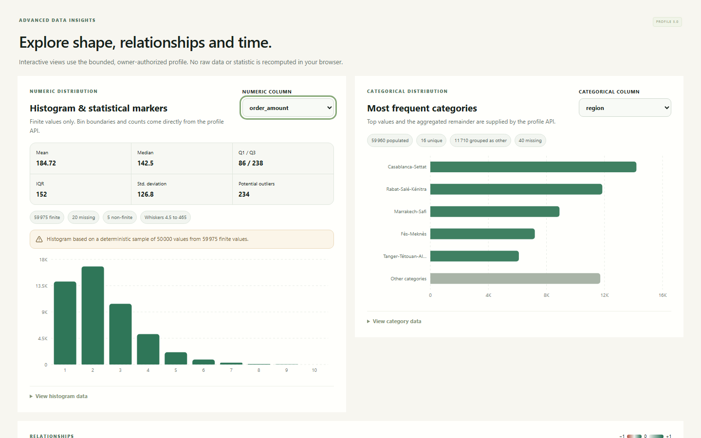
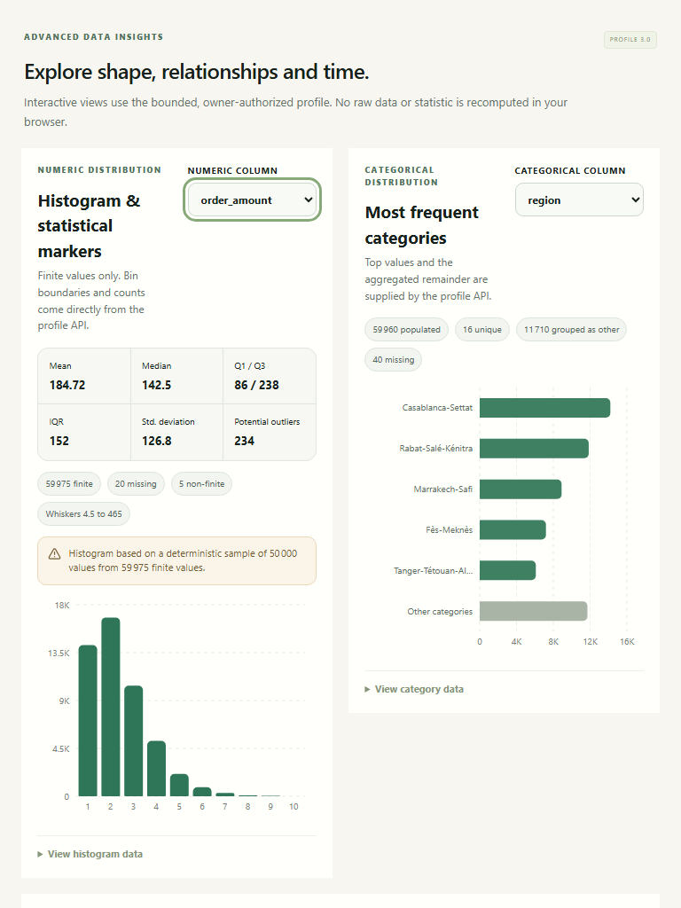
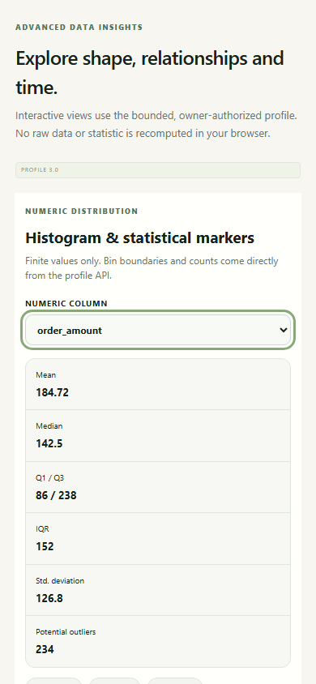
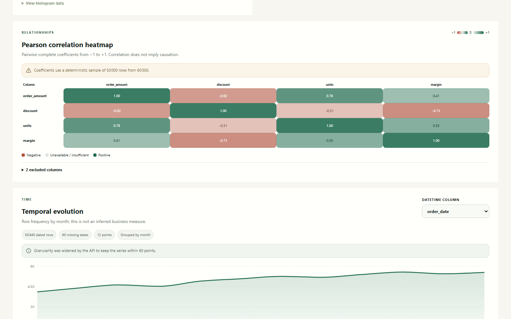

# SmartAnalytics AI

Application analytique React/TypeScript et FastAPI : ingestion CSV/XLSX, profilage statistique,
Overview dynamique, Data Explorer, DuckDB sécurisé et assistant OpenAI Responses API. La landing
et les analytics commerciales de démonstration sont explicitement séparées des imports réels,
privés à un compte authentifié.

## Résultats de référence vérifiés

Ces résultats proviennent des validations locales documentées des 12–13 novembre 2026. Les suites
utilisent des fixtures synthétiques et n'incluent ni dataset utilisateur, ni secret, ni appel OpenAI
réel. Les détails, commandes et limites de preuve figurent dans
[PROGRESS.md](docs/PROGRESS.md) et [DEPLOYMENT.md](docs/DEPLOYMENT.md).

| Vérification | Résultat observé |
| --- | ---: |
| Backend complet | **128 tests réussis**, 7 scénarios d'infrastructure conditionnels ignorés |
| PostgreSQL + Redis Docker réels | **73 tests d'intégration réussis** |
| Frontend complet | **36 tests réussis**, aucun échec |
| Qualité et build | Oxlint, TypeScript, Vite, `pip check` et `npm audit` réussis |
| Infrastructure | PostgreSQL, Redis, FastAPI et Nginx sains via Docker Compose |
| Sécurité multi-utilisateur | Sessions, CSRF et isolation inter-comptes validés |

Les sept scénarios ignorés dans la suite backend standard ont été couverts séparément contre
PostgreSQL et Redis réels. Les appels OpenAI restent simulés dans les tests.

## Captures du produit

Les captures suivantes sont générées avec la fixture QA synthétique et les vrais composants React.
Elles prouvent le rendu du profil avancé, pas un parcours authentifié complet avec des données réelles.

### Vue desktop



### Vue tablette



### Vue mobile



### Heatmap et série temporelle



## Fonctionnalités implémentées

- Inscription, connexion, déconnexion et restauration de session serveur.
- Argon2id, email normalisé unique, cookies HttpOnly/SameSite et protection CSRF.
- Routes `/app` protégées, pages `/login` et `/register`, menu du compte réel.
- Propriété contrôlée pour listes, fichiers, aperçus, profils, analytics, IA, exports et suppression.
- SQLAlchemy 2, PostgreSQL, migrations Alembic ; mode SQLite local distinct pour le développement.
- Quotas par utilisateur, mécanisme Redis partagé et journal de tokens IA.
- Design system « Verdant Intelligence » ivoire/forêt/sauge, navigation responsive, états
  vides/chargement/erreur/succès et graphiques interactifs.
- Overview réel fondé sur le profil backend : volume, complétude, doublons, statistiques numériques
  et fréquences catégorielles, sans inférence de KPI métier.
- Profil avancé rétrocompatible : qualité par colonne, quartiles, IQR, bornes/whiskers de Tukey,
  valeurs non finies distinctes des nulls et avertissements pour les petits échantillons.
- Données de visualisation structurées dans le profil `3.0` : histogrammes numériques, top 10
  catégoriel avec reste, corrélations de Pearson bornées et volumes temporels adaptatifs.
- Visualisations avancées du profil : sélecteurs de colonnes, histogrammes et distributions
  interactifs, heatmap Pearson, séries temporelles, valeurs exactes accessibles et méthodologie.

**Les datasets historiques ne sont pas perdus** : `backend/data/metadata.sqlite3` et ses fichiers
restent intacts. Ils ne sont attribués à aucun compte par défaut. Une décision administrateur
explicite est nécessaire : [procédure de migration](docs/SQLITE_TO_POSTGRES.md).

## Démarrage local

Utiliser `http://127.0.0.1:5173/app`, avec le même hostname `127.0.0.1` pour l’API afin de respecter
la politique SameSite. Vérifier et réutiliser les serveurs déjà actifs sur 8000 et 5173.

### Backend

Depuis la racine :

```powershell
cd backend
if (-not (Test-Path .venv)) { py -m venv .venv }
.\.venv\Scripts\python.exe -m pip install -r requirements-dev.txt
if (-not (Test-Path .env)) { Copy-Item .env.example .env }
.\.venv\Scripts\python.exe -m uvicorn app.main:app --reload --host 127.0.0.1 --port 8000
```

Ne pas remplacer un `.env` existant : conserver sa clé OpenAI et ajouter les nouvelles options.
Sans `DATABASE_URL`, le développement utilise **`backend/data/saas.sqlite3`**, une nouvelle base
séparée de la base historique. Les migrations de cette base de développement sont appliquées
automatiquement. Ne pas utiliser ce repli SQLite comme configuration de production.

Pour des comptes durables sur PostgreSQL, configurer la cible avant la première inscription.
Un transfert ultérieur de comptes/sessions déjà créés dans `saas.sqlite3` exige une migration
supplémentaire ; l’importeur livré vise le format historique de métadonnées, pas ce transfert complet.

### Frontend

Dans un deuxième terminal depuis la racine :

```powershell
cd frontend
npm.cmd install
if (-not (Test-Path .env.local)) { Copy-Item .env.example .env.local }
npm.cmd run dev -- --host 127.0.0.1 --port 5173
```

Créer son compte sur `/register`. `/app` redirige vers `/login` sans session. La bibliothèque réelle
d’un nouveau compte est vide. L’Overview affiche le profil factuel du dataset importé actif ; en
mode démonstration, les KPI commerciaux restent clairement identifiés comme fictifs.

## PostgreSQL et Redis

Le [Compose de développement](compose.yaml) fournit PostgreSQL 17 et Redis 7 avec volumes persistants,
mots de passe requis et ports limités à la boucle locale : 5433 et 6380. Il évite le PostgreSQL local
existant sur 5432. Le moteur Docker doit être démarré avant utilisation.

```powershell
# Depuis la racine ; définir ensuite deux mots de passe aléatoires distincts dans .env.compose.
if (-not (Test-Path .env.compose)) { Copy-Item .env.compose.example .env.compose }
docker compose --env-file .env.compose up -d postgres redis
```

Configurer les URL dans `backend/.env` d’après `backend/.env.example`, puis depuis `backend/` :

```powershell
.\.venv\Scripts\python.exe -m alembic upgrade head
.\.venv\Scripts\python.exe -m alembic current
```

Le code source attend désormais la révision `0002_dashboard_studio`. Cette migration additive a été
validée sur SQLite et PostgreSQL isolés, mais elle ne doit être appliquée à une base principale
existante qu'après validation opérateur. Une URL PostgreSQL invalide échoue ; elle ne déclenche pas
de repli SQLite. Ne pas effacer les volumes ni exécuter une réinitialisation pour résoudre un problème
de connexion. En production : rôle de migration séparé du rôle runtime.

## Configuration et secrets

Les options serveur sont lues depuis `backend/.env`, avec priorité des variables de processus
pour la configuration générale. **La clé OpenAI fait exception : elle est exclusivement chargée
depuis `backend/.env`, sans fallback vers l’environnement du processus.**

| Option | Utilisation |
| --- | --- |
| `DATABASE_URL` | URL `postgresql+psycopg://…` ; absente uniquement pour le repli SQLite de développement |
| `REDIS_URL` | Compteurs partagés ; obligatoire en production |
| `APP_ENV` | `development`, `test` ou `production` |
| `COOKIE_SECURE` | `false` pour HTTP local uniquement ; `true` obligatoire en production |
| `AUTO_MIGRATE` | Développement seulement ; aucune migration automatique en production |
| `SMARTANALYTICS_CORS_ORIGINS` | Origines frontend exactes ; aucun wildcard |
| `OPENAI_API_KEY` | Clé privée backend, jamais dans `VITE_*` |
| `OPENAI_MODEL` | Défaut `gpt-4.1-mini` |
| `SESSION_TTL_SECONDS` / `SESSION_IDLE_SECONDS` | Défauts 43200 / 1800 |
| `PROFILE_CACHE_TTL_SECONDS` | Durée du cache de profils sérialisés ; défaut 600 secondes |
| `PROFILE_CACHE_MAX_ENTRIES` / `PROFILE_CACHE_MAX_BYTES` | Bornes LRU du cache local ; défauts 8 / 8 Mio |
| `AUTH_LOGIN_LIMIT` | Défaut 10 tentatives/email/15 minutes, en plus de la limite IP |
| `AI_USER_MINUTE_LIMIT` / `AI_USER_DAILY_LIMIT` | Défauts 10 / 100 questions par utilisateur |
| `AI_INPUT_USD_PER_MILLION` / `AI_OUTPUT_USD_PER_MILLION` | Estimations facultatives selon les tarifs vérifiés par l’opérateur |

`.env`, `.env.compose`, les fichiers de données et `backend/legacy-owners*.json` sont ignorés par Git.
Les exemples ne contiennent aucun secret. Ne jamais stocker de token d’authentification dans le frontend,
localStorage ou sessionStorage. Le CSRF est conservé en mémoire et les cookies sont gérés par le navigateur.

## API

Documentation : `http://127.0.0.1:8000/docs`.
Les clients authentifiés conservent le cookie et transmettent l’origine autorisée et `X-CSRF-Token`
pour les requêtes modifiant l’état, y compris connexion, inscription et déconnexion.

| Endpoint | Rôle |
| --- | --- |
| `GET /api/health` / `GET /api/ready` | Vie / disponibilité DB et Redis configuré |
| `GET /api/auth/session` | Restauration de session, identité éventuelle et jeton CSRF |
| `POST /api/auth/register`, `/login`, `/logout` | Authentification réelle et révocation serveur |
| `GET /api/auth/me` | Utilisateur authentifié, sans hash ni secret de session |
| `GET /api/auth/usage` | Usage IA de l’utilisateur courant uniquement |
| `GET`, `POST /api/datasets` | Liste privée et upload attribué à l’identité serveur |
| Détail, `/preview`, `/profile`, `/query`, `/ai/ask` | Accès contrôlé à chaque dataset |
| `GET`, `POST /api/datasets/{id}/export` | Export CSV protégé, borné à 200 lignes |
| `DELETE /api/datasets/{id}` | Suppression privée, confirmée dans l’interface |

Un utilisateur anonyme reçoit 401 ; un UUID appartenant à un autre compte reçoit 404, comme un
UUID absent. L’utilisateur frontend ne choisit jamais le propriétaire d’un upload.

## Assistant IA

Le modèle produit un plan Pydantic strict depuis le schéma autorisé. Le moteur DuckDB valide
colonnes, opérateurs et alias puis calcule les résultats ; aucun SQL/Python généré n’est exécuté.
Une seconde étape explique seulement les agrégats réellement calculés. Le graphique et le tableau
partagent les mêmes lignes. Une ambiguïté doit produire une clarification et une opération hors
contrat un refus. Les questions restent indépendantes.

Exemples sur [la fixture synthétique](docs/fixtures/usability-sales.csv), après import dans son compte :
« Somme de amount par category » (A = 15, B = 20), « Moyenne de amount » (35/3),
« Somme de amount par mois de date » (janvier = 30, février = 5).

Questions, métadonnées et agrégats bornés sont envoyés à OpenAI ; ils peuvent rester sensibles.
`store=False` n’est pas une garantie de rétention zéro du fournisseur. L’explication reste
probabiliste : le plan et le tableau constituent les éléments vérifiables.

Quotas Redis ou SQL atomiques par utilisateur ; échec fermé si Redis configuré est indisponible.
Timeout réseau de 20 secondes, un retry SDK, 2 500 tokens de sortie par étape. Le serveur arrête
son attente après 90 secondes et signale l’annulation aux étapes suivantes ; il ne tue pas une
opération HTTP/DuckDB déjà engagée. Les tokens connus sont enregistrés même si le client se déconnecte.
Les coûts USD sont des estimations facultatives, pas une facture ni un plafond financier garanti.

## Vérification

```powershell
# Depuis backend/
.\.venv\Scripts\python.exe -m pytest -q
.\.venv\Scripts\python.exe -m pip check
# PostgreSQL temporaire isolé, si les binaires PostgreSQL 17 Windows sont disponibles :
.\.venv\Scripts\python.exe scripts/test_postgres.py
# PostgreSQL + Redis réels dans un projet Compose jetable (moteur Docker requis) :
.\.venv\Scripts\python.exe scripts/test_infrastructure.py

# Depuis frontend/
npm.cmd test
npm.cmd run lint
.\node_modules\.bin\tsc.cmd -b --pretty false
npm.cmd run build
npm.cmd audit
```

Les tests incluent deux utilisateurs, CSRF, rotation/révocation/expiration des sessions,
limites d’authentification, accès croisés à tous les endpoints privés, exports, uploads malveillants,
comptage des tokens, quotas atomiques et import historique avec vérification SHA-256 des sources.
Le script PostgreSQL crée son propre cluster temporaire SCRAM et ses bases de test, puis les retire ;
il ne réutilise pas le serveur local existant et n’affiche pas ses credentials.

Validation Docker Compose des 12–13 novembre 2026 : **107 tests backend réussis et 7 ignorés**
dans le passage standard (6 cas Redis et 1 cas PostgreSQL exécutés séparément), puis **73 tests
d'intégration réussis** contre PostgreSQL et Redis Docker réels. Les **34 tests frontend**, Oxlint,
TypeScript, les builds de production, `pip check` et `npm audit` ont réussi. OpenAI est simulé dans
les suites et aucun appel fournisseur réel n'a été effectué pendant cette validation.

La pile complète PostgreSQL/Redis/Alembic/FastAPI/Nginx est saine sur les ports loopback
5433/6380/8001/5174. Un parcours HTTP à travers Nginx a confirmé deux comptes isolés, un upload
CSV, les agrégats A = 15 et B = 20, les refus anonymes et inter-comptes, puis la persistance de la
session et du dataset après redémarrage de FastAPI. Une clé synthétique a persisté après redémarrage
Redis avec AOF. Après inventaire et autorisation explicite, les quatre comptes, quatre sessions,
deux datasets et deux fichiers QA ont été supprimés de façon ciblée. La session anonyme a été
conservée ; aucune donnée historique, clé Redis, base ou volume n'a été supprimé.

Les résultats exacts et limites de preuve figurent dans [PROGRESS.md](docs/PROGRESS.md).

Validation du lot Advanced Data Insights 1 : **118 tests backend réussis et 7 conditionnels
ignorés**, **34 tests frontend réussis**, Oxlint, TypeScript, build Vite et `pip check` réussis.
Le contrôle interactif de navigateur reste indisponible. Une vérification partielle avec Google
Chrome headless a validé la landing et la connexion à 1440 px et 500 px ; la
[checklist visuelle](docs/VISUAL_QA_CHECKLIST.md) reste à exécuter à 390 px et sur les pages privées.

Validation du lot Advanced Data Insights 2 : **128 tests backend réussis et 7 conditionnels
ignorés**, **34 tests frontend réussis**, Oxlint, TypeScript, build Vite et `pip check` réussis.
Le lot étend uniquement les contrats et données de profil ; aucun composant visuel, schéma SQL ou
appel OpenAI n’a été ajouté.

Validation du lot Advanced Data Insights 3 : **36 tests frontend réussis**, Oxlint, TypeScript,
build Vite et audit npm réussis. Les visualisations sont chargées à la demande et exploitent
exclusivement le profil API `3.0`, sans recalcul statistique ni transmission externe.

Validation finale du lot 4 : **128 tests backend réussis** (7 scénarios d'infrastructure conditionnels
ignorés dans cette suite), puis **73 tests réussis** contre PostgreSQL et Redis Docker isolés ; **36 tests
frontend réussis**, Oxlint, TypeScript, build Vite, `pip check` et audit npm réussis. Google Chrome a
validé la fixture synthétique à 1440×900, 768×1024 et 390×844, avec focus clavier visible, tableaux
accessibles et absence de débordement horizontal global. Les [captures](docs/screenshots) et le
[scénario de démonstration](docs/DEMO_SCRIPT.md) sont disponibles. Cette preuve ne valide pas le
parcours authentifié interactif, qui reste dans la [checklist manuelle](docs/VISUAL_QA_CHECKLIST.md).

## Frontières avant un déploiement public

Cette livraison n’est pas présentée comme prête à exposer publiquement.
`APP_ENV=production` exige PostgreSQL, Redis, cookies Secure et origines HTTPS, mais ne remplace pas
la mise en place de TLS, rôles DB minimaux, réseau privé, stockage partagé protégé, sauvegardes et
restaurations vérifiées, supervision, maintenance des sessions/compteurs et tests du proxy de confiance.

Le problème Windows/WSL 2/Docker Desktop est résolu : WSL 3.0.5, le moteur Docker Linux 29.8.2
et Compose v5.6.0 répondent. Le Compose complet est construit, démarré et validé avec ses
healthchecks ; Alembic est à la révision `0001_multi_user`. PostgreSQL Windows sur 5432 n'a pas été
utilisé. Les trois volumes Docker sont conservés et aucun `down -v`, reset Alembic ou `FLUSHDB`
n'a été exécuté. Commandes, ports, santé et limites : [DEPLOYMENT.md](docs/DEPLOYMENT.md).

La revue visuelle manuelle des pages privées dans Google Chrome reste à exécuter sur
`http://127.0.0.1:5174/app`. Chrome headless a validé la landing et la connexion en desktop et
petit écran, mais cette preuve partielle ne remplace pas un parcours clavier/interactif complet.
Email de vérification, reset de mot de passe, MFA, screening de mots de passe compromis, quotas de
stockage et audit immuable ne sont pas implémentés. La lecture/parsing des fichiers n’a pas de limite
CPU stricte globale. Les fichiers et la base ne forment pas une transaction atomique.

Architecture et restrictions détaillées : [SAAS_ARCHITECTURE.md](docs/SAAS_ARCHITECTURE.md).
Migration, sauvegarde, inventaire et décisions de propriété : [SQLITE_TO_POSTGRES.md](docs/SQLITE_TO_POSTGRES.md).
