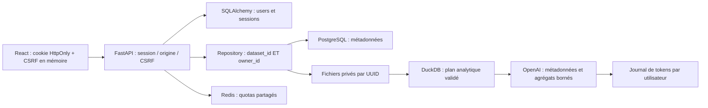

# Architecture SaaS multi-utilisateur

Date : 12 novembre 2026. Le tenant est ici un compte utilisateur, sans partage entre comptes.
Cette architecture ne comprend pas encore d’organisations ou d’équipes.

## Périmètre et persistance

React/TypeScript et le design existant sont conservés. FastAPI contrôle l’authentification,
la propriété des datasets, les limites et les appels OpenAI. DuckDB ne reçoit que les plans
Pydantic validés et les données du fichier sélectionné, après autorisation.

PostgreSQL avec SQLAlchemy 2 est la cible de déploiement. Pour le développement sans connexion
PostgreSQL configurée, le backend utilise **un nouveau** `backend/data/saas.sqlite3`.
Il ne réutilise pas automatiquement l’ancien `metadata.sqlite3`.
Configurer une URL PostgreSQL qui échoue ne provoque jamais de repli silencieux vers SQLite.
En mode production, PostgreSQL et Redis sont obligatoires ; SQLite est refusé.

| Table | Rôle |
| --- | --- |
| `users` | UUID, email normalisé unique, hash Argon2id, date de création, activation |
| `user_sessions` | Hash SHA-256 du cookie aléatoire, utilisateur éventuel, secret CSRF, expiration absolue et dernière activité |
| `dataset_metadata` | UUID stable, propriétaire FK, JSON historique conservé, extension et date |
| `ownership_decisions` | Décisions explicites de l’opérateur pour les imports historiques |
| `rate_counters` | Compteurs atomiques SQL pour le développement sans Redis |
| `ai_usage` | Utilisateur, dataset, modèle, tokens d’entrée/sortie rapportés, résultat de l’appel SDK et date |
| `dashboards` | Dashboard privé, propriétaire, métadonnées, révision optimiste et timestamps |
| `dashboard_widgets` | Requête analytique validée, configuration visuelle, disposition et snapshots du dataset |

La migration Alembic `0001_multi_user` crée seulement ces tables. Elle ne modifie ni la base
historique ni les fichiers. Un downgrade d’une base SaaS contenant comptes, datasets ou usage
est refusé pour éviter une suppression silencieuse. Une base neuve peut être migrée dans les deux sens.
Le schéma ORM et le schéma migré sont comparés dans les tests.

La migration additive `0002_dashboard_studio` crée les deux tables Dashboard Studio. Les widgets
sont supprimés en cascade avec leur dashboard, mais restent présents avec `dataset_id = NULL` quand
leur dataset est supprimé. Un downgrade de `0002` est refusé tant que des dashboards existent.

## Sessions et CSRF

- Mot de passe : 15 à 128 caractères, majuscule, minuscule, chiffre et symbole.
  Argon2id : 64 Mio, trois itérations, parallélisme deux. Maximum quatre opérations de hash/
  vérification simultanées par processus. Un hash factice limite la différence de traitement
  entre compte inexistant et mauvais mot de passe.
- Email : validation et normalisation, comparaison sans distinction de casse, contrainte unique SQL.
- Cookie aléatoire de 256 bits, stocké sous forme de hash en base, renouvelé à chaque inscription/
  connexion. Ni cookie d’authentification ni jeton équivalent n’est retourné dans le JSON.
- Cookie `HttpOnly`, `SameSite=Lax`, sans `Domain`, chemin `/`. Avec `COOKIE_SECURE=true`, le nom
  est `__Host-smartanalytics_session` et l’attribut `Secure` est activé. La dérogation HTTP locale
  utilise `COOKIE_SECURE=false` et un autre nom de cookie ; elle est refusée en production.
- Sessions : 12 heures absolues, 30 minutes d’inactivité par défaut. Ces durées sont configurables.
  La déconnexion supprime la session en base et expire le cookie. Un ancien cookie ne peut plus
  être rejoué. Un utilisateur désactivé ne peut pas conserver sa session.
- `GET /api/auth/session` restaure la session ou crée une session anonyme courte pour préparer
  le formulaire. Il fournit un jeton CSRF, pas une authentification fictive.
- Inscription, connexion et déconnexion nécessitent aussi CSRF. Pour toute mutation privée,
  l’origine doit correspondre exactement à une origine autorisée et `X-CSRF-Token` doit correspondre
  au secret de la session. Les origines wildcard, chemins dans les origines et requêtes explicitement
  `Sec-Fetch-Site: cross-site` sont refusés. Le jeton est comparé en temps constant ; un jeton non ASCII
  produit un refus, pas une erreur serveur.
- Les requêtes privées sont autorisées avant lecture du multipart/JSON. Corps non upload limités
  à 64 Kio ; uploads limités à 20 Mio de fichier et une enveloppe multipart bornée, y compris sans
  `Content-Length`. Les réponses privées ne sont pas mises en cache.

Les durées et quotas sont vérifiés par le serveur. La validation HTML des formulaires n’est pas
une frontière de sécurité. Les erreurs de connexion restent génériques.

## Isolation des datasets

La dépendance d’authentification fournit l’identité serveur. Aucun `user_id` du frontend n’est
utilisé comme propriétaire. Le service refuse l’absence de propriétaire et le repository filtre
chaque sélection avec `dataset_id AND owner_id`. La liste est elle aussi filtrée.

Cela couvre upload, détail, aperçu, profil, requête, assistant, export GET/POST et suppression.
L’accès à un UUID existant appartenant à un autre compte renvoie le même 404 qu’un UUID absent.
L’autorisation de l’assistant précède l’admission aux quotas, l’accès au fichier et OpenAI.

Les fichiers restent dans un répertoire privé, hors des assets Vite, avec UUID imprévisible et
extension autorisée. Les chemins sont résolus et doivent rester dans le répertoire de stockage.
Un échec d’allocation ne supprime jamais un fichier préexistant portant le même nom.

Les imports historiques peuvent être placés en quarantaine avec `owner_id=NULL`. Ils ne sont pas
des datasets actifs d’un compte : aucune route utilisateur ne les rend accessibles. Seule une
décision explicite d’opérateur peut les attribuer. Aucun premier compte créé ne reçoit les anciens fichiers.
Voir [la procédure de migration](SQLITE_TO_POSTGRES.md).

L’export de l’Explorer passe par le backend et revérifie la session/propriété, au lieu de télécharger
seulement une copie des lignes mises en cache. Il porte sur le plan appliqué et sa page bornée,
au maximum 200 lignes. Les chaînes pouvant devenir des formules de tableur sont neutralisées.

## Limites et suivi IA

- Clé OpenAI exclusivement lue depuis `backend/.env`. Aucun envoi de clé au frontend, aux prompts
  ou aux journaux d’usage. Le modèle reste configurable, avec `gpt-4.1-mini` par défaut.
- Plans stricts, validation Pydantic et validation métier DuckDB conservées ; aucun SQL/Python libre.
- Question de 2 000 caractères ; schéma de 100 colonnes / 24 000 caractères maximum ; résultats
  de 50 lignes et contexte explicatif agrégé de 24 000 caractères maximum ; 2 500 tokens de sortie
  par étape. Les données brutes ne sont pas envoyées pour l’explication.
- Dix questions/minute et cent questions/jour par utilisateur par défaut, fenêtres fixes.
  Redis exécute un script atomique `INCR`/`EXPIRE`, avec clés pseudonymisées. Si Redis configuré
  est indisponible, les opérations limitées échouent en 503 ; aucun repli local silencieux.
  Sans Redis en développement, un upsert SQL atomique assure la persistance des compteurs.
- Connexion : trente tentatives/IP/minute, dix tentatives/email/quinze minutes par défaut.
  L’inscription est aussi limitée à cinq/IP/minute, et la création de session anonyme à soixante/IP/minute.
  Les réponses 429 contiennent `Retry-After`.
- Deux analyses IA simultanées par processus. Timeout réseau SDK de 20 secondes, un retry SDK.
  Le serveur cesse d’attendre après 90 secondes. Un disconnect positionne un signal d’annulation,
  contrôlé avant un nouvel appel fournisseur et avant le calcul. Il ne tue pas un thread en plein
  DuckDB/HTTP : une opération déjà engagée peut terminer et être facturée ; son slot reste occupé.
- DuckDB est interrompu après dix secondes de calcul, avec ses limites mémoire/threads existantes.
  La lecture/parsing du fichier n’a pas encore de deadline CPU stricte.
- `GET /api/auth/usage` retourne uniquement les compteurs de l’utilisateur courant. Le journal
  conserve les tokens rapportés par le SDK et les erreurs connues, sans questions ni résultats.
  Une estimation USD est fournie seulement si les deux tarifs ont été configurés par l’opérateur.
  Ce n’est pas une facture : les retries internes, usages inconnus après timeout, remises de cache
  et changements de tarifs/modèle peuvent nécessiter une réconciliation avec OpenAI.

Les limites de questions ne sont pas un plafond financier contractuel. Configurer aussi un budget
fournisseur et surveiller les coûts. Les agrégats peuvent rester sensibles ; `store=False` ne garantit
pas une rétention fournisseur nulle.

## Frontend

`/` reste public. `/login` et `/register` utilisent le design ivoire/forêt/sauge. `/app` et ses
sous-routes attendent la restauration de session et redirigent les utilisateurs anonymes.
Une erreur réseau de restauration expose un réessai et ne donne pas accès au workspace.

Le cookie est géré uniquement par le navigateur (`credentials: include`, XHR `withCredentials`).
Le CSRF reste en mémoire. Aucun token d’authentification n’est stocké dans localStorage/sessionStorage.
Le chargement de session est mutualisé pour éviter des cookies anonymes concurrents au montage React.
Une expiration API réinitialise l’identité. Le menu du compte expose la vraie adresse et la déconnexion.
Le workspace est monté avec une clé utilisateur : changement de compte = vidage des états privés.
BroadcastChannel signale connexion/déconnexion aux autres onglets compatibles, sans transporter de secret.
L’Overview conserve son sample explicitement démo ; la bibliothèque réelle d’un nouveau compte est vide.

## Exploitation et limites de déploiement

- `APP_ENV=production` exige PostgreSQL, Redis, cookies Secure et origines HTTPS explicites.
  Les migrations doivent être exécutées avant les workers, avec un rôle de migration distinct.
- `/api/health` est un test de vie ; `/api/ready` vérifie la base et Redis si configuré.
- Utiliser TLS, réseau privé pour PostgreSQL/Redis et rôles à privilèges minimaux. Compose est
  destiné au développement local, pas au durcissement d’un déploiement public.
- Plusieurs instances doivent partager le répertoire privé des fichiers (ou un stockage objet
  avec autorisation équivalente). PostgreSQL/Redis partagés seuls ne partagent pas les CSV/XLSX.
- Configurer explicitement les proxys de confiance et filtrer les headers transférés ; ne pas
  accepter des `X-Forwarded-For` arbitraires pour les limites IP.
- Aucun email de vérification, reset de mot de passe, MFA, interface web d’administration,
  contrôle de mots de passe compromis, quota de stockage ou journal d’audit immuable n’est implémenté.
- Les sessions expirées sont purgées lors de l’émission d’une nouvelle session ; une maintenance
  planifiée des sessions/compteurs/journaux reste à organiser pour un service durable.
- Les fichiers et la base ne partagent pas une transaction atomique : prévoir sauvegardes,
  réconciliation des fichiers orphelins et tests de restauration avant exploitation publique.
- L’instance Redis réelle, le lancement Compose, le TLS et les contrôles visuels des nouvelles pages
  n’ont pas été validés dans cet environnement. Ne pas présenter cette livraison comme prête à exposer publiquement.

Références de conception : [sessions OWASP](https://cheatsheetseries.owasp.org/cheatsheets/Session_Management_Cheat_Sheet.html),
[CSRF OWASP](https://cheatsheetseries.owasp.org/cheatsheets/Cross-Site_Request_Forgery_Prevention_Cheat_Sheet.html),
[transactions SQLAlchemy 2](https://docs.sqlalchemy.org/en/20/orm/session_basics.html),
[migrations Alembic](https://alembic.sqlalchemy.org/en/latest/tutorial.html).
